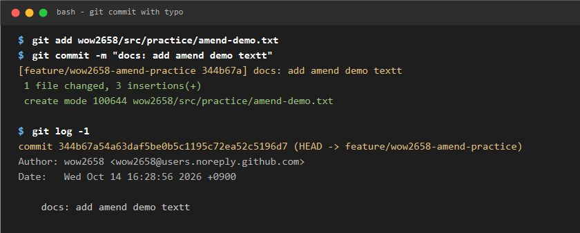
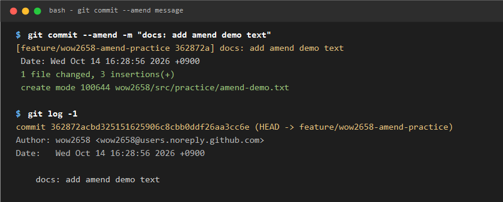
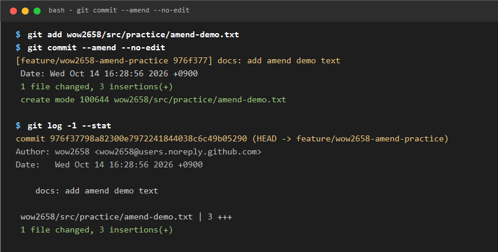
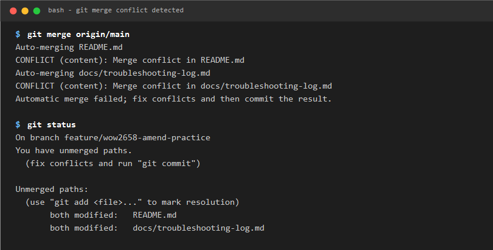
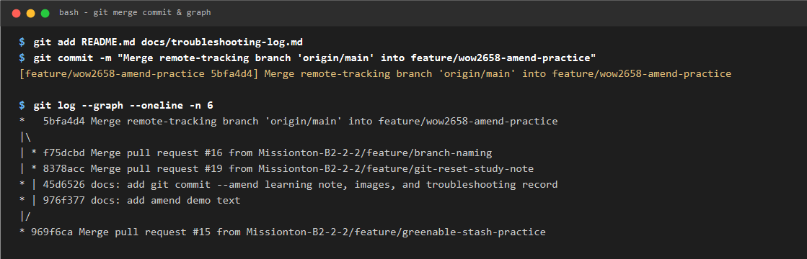

# Git commit --amend 학습 노트

## 작성자

- wow2658

## 학습 목적

가장 최근에 작성한 커밋의 메시지를 수정하거나, 누락된 변경 사항을 기존 커밋에 합치는 방법을 학습한다.

## 핵심 개념

- `git commit --amend`: 가장 최근의 커밋(HEAD)을 수정하여 새로운 커밋으로 대체한다.
- `git commit --amend -m "새로운 커밋 메시지"`: 커밋 메시지만 간단히 수정할 때 사용한다.
- `git commit --amend --no-edit`: 커밋 메시지는 유지하고 새로 스테이징된 변경 사항만 직전 커밋에 병합할 때 사용한다.

## 실습 과정

### 1. 오타가 포함된 초기 커밋 생성
`amend-demo.txt` 파일을 생성하고 오타가 포함된 커밋 메시지로 커밋을 생성했다 (`docs: add amend demo textt`).

```bash
git add wow2658/src/practice/amend-demo.txt
git commit -m "docs: add amend demo textt"
git log -1
```



### 2. `git commit --amend`로 메시지 수정
`git commit --amend -m` 명령을 실행하여 직전 커밋 메시지를 올바르게 수정했다. 커밋 해시가 갱신되며 메시지가 수정된 것을 확인했다.

```bash
git commit --amend -m "docs: add amend demo text"
git log -1
```



### 3. `--no-edit`으로 누락된 내용 직전 커밋에 합치기
`amend-demo.txt` 파일에 누락되었던 변경 사항을 수정한 뒤, 메시지는 유지한 채 기존 커밋에 병합했다.

```bash
git add wow2658/src/practice/amend-demo.txt
git commit --amend --no-edit
git log -1 --stat
```



## 실습 결과

추가 커밋을 남기지 않고도 가장 최근 커밋의 메시지 오타와 누락된 코드를 깔끔하게 정정할 수 있었다.

## 사용하면 좋은 상황

방금 커밋을 완료했는데 커밋 메시지에 오타가 발견되었거나, 깜빡하고 파일 하나를 커밋에 포함하지 못했을 때 유용하다.

## 주의점

이미 원격 저장소(`origin`)에 `push`된 커밋에 대해 `amend`를 수행하면 로컬과 원격의 커밋 히스토리가 달라져 충돌이 발생하거나 강제 푸시(`git push --force`)가 필요하게 된다. 따라서 협업 중인 공유 브랜치에 이미 push된 커밋에는 사용을 지양해야 한다.

---

## 실전 협업 트러블슈팅: Merge Conflict 해결

PR 생성 시 팀원의 선행 머지로 인해 공통 문서(`troubleshooting-log.md`, `README.md`)에서 충돌이 발생했을 때, `git merge origin/main`을 통해 최신 변경사항을 가져와 수동으로 해결했다.

1. **충돌 감지**: `git merge origin/main` 실행 후 CONFLICT 발생
2. **수동 병합**: 팀원들의 기록을 보존하고 이슈 #6 순서(amend -> reset -> stash)대로 재정렬
3. **머지 커밋 생성 및 푸시**: 머지 커밋(`5bfa4d4`)을 생성하여 PR 상태를 `Able to merge`로 정상 복구



